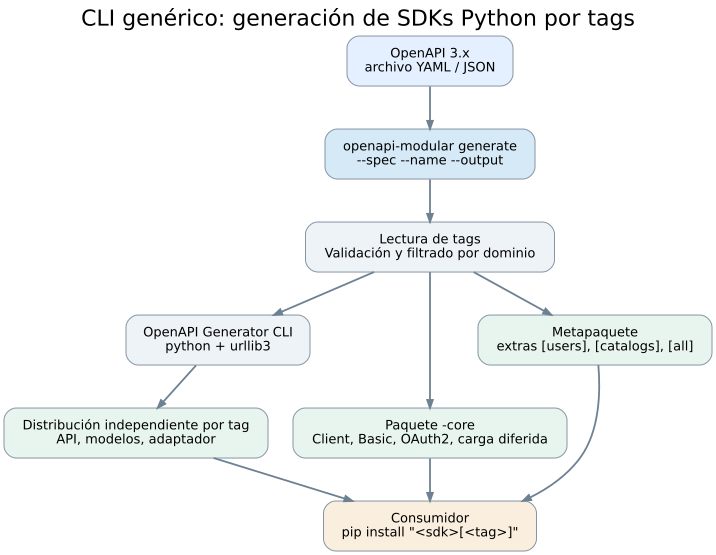
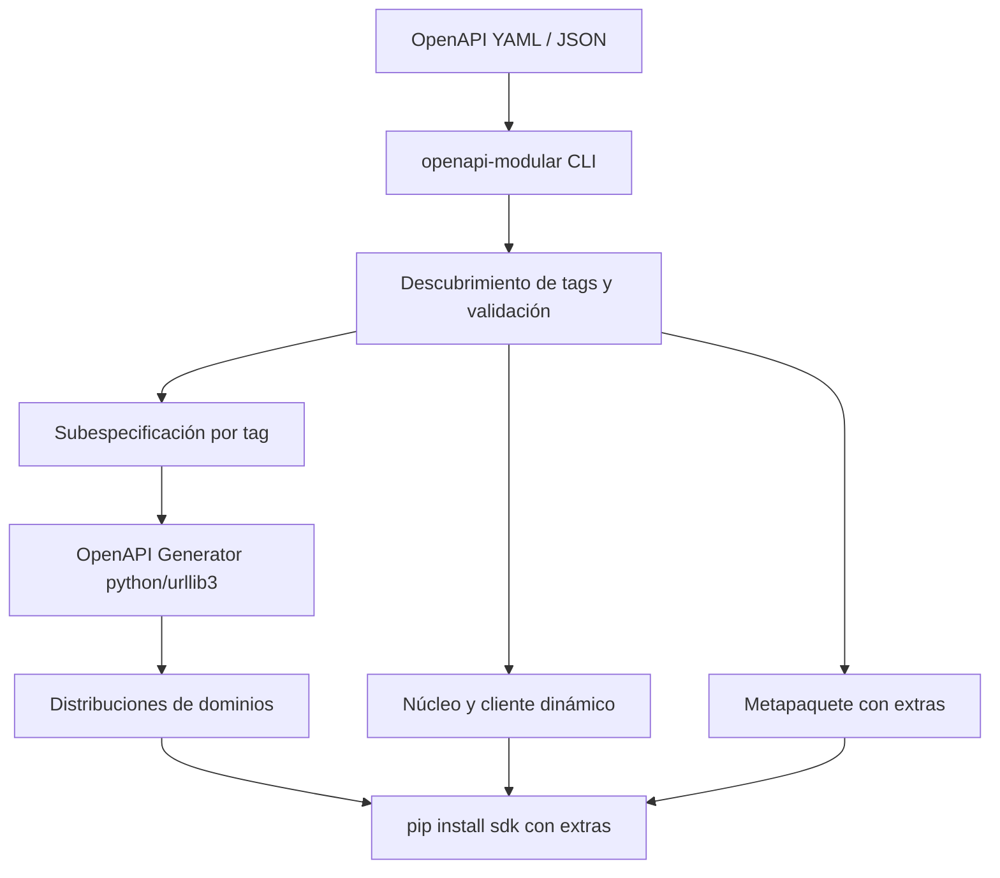
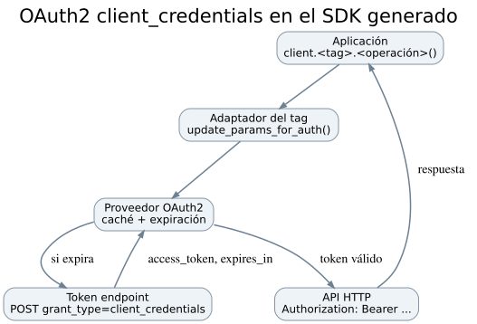
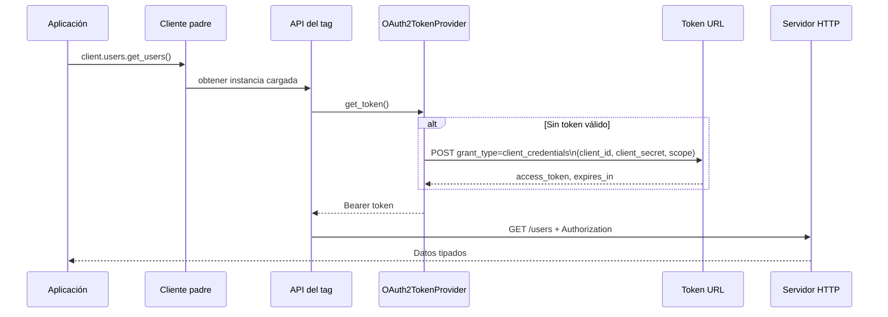

# Plan técnico: CLI genérica de generación de SDKs Python modulares

**Estado:** MVP 0.1 funcional a nivel de orquestación y runtime básico. **Entregable:** solo la herramienta `openapi-modular-cli`; las distribuciones SDK se generan en cada ejecución. No se incluye un SDK pregenerado.

## 1. Objetivo y restricciones

Construir una herramienta ejecutable tantas veces como sea necesario contra distintas especificaciones OpenAPI:

```bash
openapi-modular generate \
  --spec /especificaciones/api.yaml \
  --name nombre-del-sdk \
  --module nombre_del_sdk \
  --output /artefactos/sdk
```

Una especificación con `tags` `Users`, `Catalogs` y `Orders` genera cuatro piezas instalables visibles (núcleo + 3 dominios) y un **metapaquete** que permite instalar `nombre-del-sdk[users]`, `nombre-del-sdk[catalogs]`, etc. El nombre depende del argumento `--name`; no hay SDK corporativo codificado en el generador.

### Condiciones clave

- Mantener **OpenAPI Generator** como motor del cliente HTTP y los modelos.
- Agrupar cada `tag` en su **propia distribución wheel**; los extras no permiten excluir archivos de un único wheel.
- Exponer un **Client padre** con `client.<tag>.<operationId>()` gracias a entry points y carga diferida.
- Autenticación HTTP Basic y OAuth2 `client_credentials` configurada en runtime: `token_url`, `client_id`, `client_secret`, `scope` NO se extraen del OpenAPI.
- No incluir credenciales en el código generado ni el manifiesto.
- Generación local, sin servidores propios ni SaaS.

## 2. Diagrama de arquitectura





## 3. Jerarquía de archivos DEL GENERADOR (contenido de este ZIP)

```text
openapi-modular-cli/
├── pyproject.toml                   # Empaquetado e instalación CLI
├── README.md                        # Uso de la herramienta
├── PLAN_TECNICO.md                  # Este plan
├── src/openapi_modular_cli/
│   ├── __init__.py
│   ├── __main__.py                  # python -m openapi_modular_cli
│   ├── cli.py                       # CLI: inspect / generate
│   ├── spec.py                      # tags, referencias, filtrado, seguridad
│   ├── build.py                     # distribución, metapaquete, ejecución externa
│   └── templates/runtime/
│       ├── auth.py                  # Token provider + Basic
│       ├── adapter.py               # Auth por operación / adaptador
│       ├── client.py                # Client padre y entry points
│       └── __init__.py
├── tests/
│   ├── conftest.py                  # Definiciones sintéticas en memoria
│   ├── test_spec.py
│   ├── test_build.py
│   └── test_runtime.py
└── docs/
    ├── arquitectura.dot
    ├── arquitectura.svg
    ├── arquitectura.png
    ├── secuencia.dot
    ├── secuencia.svg
    └── secuencia.png
```

**No hay** clientes SDK ya generados dentro del entregable: únicamente el código de la herramienta y sus pruebas.

## 4. Jerarquía de archivos QUE LA CLI PRODUCIRÁ (ejemplo paramétrico)

Para `--name <nombre>`, `--module <modulo>` y `tags` `<tag-a>`, `<tag-b>`:

```text
<output>/
├── manifest.json
├── specs/
│   ├── <tag-a>.yaml
│   └── <tag-b>.yaml
└── packages/
    ├── <nombre>/
    │   ├── pyproject.toml           # [project.optional-dependencies]
    │   └── src/<modulo>/
    │       ├── __init__.py          # exporta Client
    │       ├── __init__.pyi         # nombres de tags para IDE
    │       └── py.typed
    ├── <nombre>-core/
    │   ├── pyproject.toml
    │   └── src/<modulo>_core/
    │       ├── client.py
    │       ├── adapter.py
    │       ├── auth.py
    │       └── known_domains.py
    ├── <nombre>-<tag-a>/
    │   ├── pyproject.toml           # entry point del tag
    │   └── src/
    │       ├── <modulo>_<tag-a>/__init__.py
    │       └── <modulo>_<tag-a>_generated/
    │           ├── api_client.py
    │           ├── configuration.py
    │           ├── api/...
    │           └── models/...
    └── <nombre>-<tag-b>/...
```

La herramienta genera dinámicamente los `pyproject.toml` para que el instalador pip resuelva el metapaquete y los extras. El **código OpenAPI Generator** se incluye en cada distribución por tag; la autenticación y el descubrimiento de módulos viven en la distribución core.

## 5. Implementación, fichero por fichero

| Archivo | Implementación | Resultado |
|---|---|---|
| `cli.py` | `argparse` con comandos `inspect` y `generate`; argumentos `--spec --name --module --output --generator --package-version` | CLI reusable |
| `spec.py` | `yaml.safe_load`, `discover_tags`, `slugify`, `filtered_spec`, `security_metadata` | Una especificación derivada por tag |
| `build.py` | Orquestación de subprocess, copiar archivos, generar manifest y metadata PEP 621, dependencias + extras | Ruedas instalables después de construir/publicar |
| `templates/runtime/auth.py` | `OAuth2TokenProvider` HTTPX, caching y expiración, Basic | Autenticación centralizada |
| `templates/runtime/adapter.py` | Sobrescribe `update_params_for_auth()` en el cliente generado y aplica el tipo de seguridad de cada operación | Authorization sin duplicar métodos API |
| `templates/runtime/client.py` | Entry points `'<modulo>.domains'`, carga diferida, `Client.basic()` y `Client.oauth2()` | Fachada padre |
| `tests/` | Pruebas de seguridad, filtrado, manifest, mock de generador y CLI | Regresión sin APIs externas |

### 5.1. Inspección de los tags

```python
spec = load_spec(Path(args.spec))
tags = discover_tags(spec)
for slug, tag in tags.items():
    print(slug, tag)
```

En `spec.py` se rechazan tags sin slug Python válido, colisiones (`Users` vs `Users!`) y operaciones sin tags. Operaciones con más de un tag se copiarán a cada dominio, con coste de duplicación documentado.

### 5.2. Filtrado de referencias

```python
sub_spec = filtered_spec(spec, tag)
# Mantiene solo paths con operaciones del tag,
# sus $refs transitivas internas y los securitySchemes usados.
```

Las referencias externas (`file.yaml#/...`, HTTP URL) se rechazan, para no generar SDKs incompletos silenciosamente. La lista de `schemas` retenidos es el cierre transitivo de las referencias internas desde las operaciones. **Limitación:** mapeos por discriminador, callbacks y referencias complejas requieren una etapa de resolución adicional.

### 5.3. Invocación real del motor

```python
command = [
    generator, "generate",
    "-i", str(spec_filtrada),
    "-g", "python",
    "-o", str(directorio_temporal),
    "--additional-properties",
    f"packageName={modulo}_users_generated,"
    f"projectName={distribucion}-users,"
    f"packageVersion={version},library=urllib3,sourceFolder=src",
    "--global-property", "apiTests=false,modelTests=false,apiDocs=false,modelDocs=false",
]
subprocess.run(command, check=True)
```

La invocación anterior es esquemática: `build.py` construye esos parámetros con el slug real de cada `tag`, no el literal `users`.

### 5.4. Extras creados automáticamente

```toml
[project]
name = "<nombre-sdk>"
dependencies = ["<nombre-sdk>-core==1.0.0"]

[project.optional-dependencies]
users = ["<nombre-sdk>-users==1.0.0"]
catalogs = ["<nombre-sdk>-catalogs==1.0.0"]
all = ["<nombre-sdk>-users==1.0.0", "<nombre-sdk>-catalogs==1.0.0"]
```

**Importante:** esto requiere publicar los wheels `-users`, `-catalogs`, `-core` y el metapaquete, no simplemente un único wheel gigantesco.

### 5.5. Cliente padre sin imports obligatorios de los tags

```python
from importlib.metadata import entry_points

# Dentro de Client.__getattr__(self, name):
eps = entry_points(group=ENTRYPOINT_GROUP)
factory = next(ep.load() for ep in eps if ep.name == name)
self._domains[name] = factory(self)
return self._domains[name]
```

Cuando el extra no está instalado, la excepción informa `pip install '<nombre-sdk>[<tag>]'`.

### 5.6. OAuth2 por variables de entorno en runtime

```python
import os
from nombre_del_sdk import Client  # Sustituir por el módulo indicado en --module

with Client.oauth2(
    host=os.environ["API_HOST"],
    token_url=os.environ["OAUTH_TOKEN_URL"],
    client_id=os.environ["OAUTH_CLIENT_ID"],
    client_secret=os.environ["OAUTH_CLIENT_SECRET"],
    scope=os.getenv("OAUTH_SCOPE", ""),
) as client:
    ...
```

`token_url` se suministra en tiempo de ejecución; **no se lee** de OpenAPI ni se escribe en el generador. Un `OAuth2TokenProvider` cachea tokens y vuelve a pedirlos al caducar. HTTP Basic usa `Client.basic(host=..., username=..., password=...)`.

La plantilla de adaptador busca los `security` de cada operación (por método y ruta), selecciona entre alternativas OR y construye el encabezado correcto. Combinaciones AND y otros schemes no se aceptan en v0.1.

## 6. Diagrama de secuencia: obtención de token





## 7. Flujo de instalación y publicación

```mermaid
flowchart LR
    A[CLI genera paquetes] --> B[python -m build por distribución]
    B --> C[Publicación en PyPI/índice privado]
    C --> D[pip install "SDK[users]"]
    D --> E[SDK core y users disponibles]
    D --> F[catalogs no instalado]
```

El generador no hace publicación ni necesita credenciales de un registro; esto permite integrar esa fase con GitHub Actions, GitLab CI o Jenkins.

## 8. Hoja de ruta

| Fase | Entregables | Estado |
|---|---|---|
| F1: CLI, análisis de OpenAPI y tags | `inspect`, parseo, filtrado | Terminado |
| F2: emisión de proyectos instalables | `build.py`, pyproject y extras dinámicos | Terminado |
| F3: integración con motor de generación | subprocess OpenAPI Generator, copia de código | Implementado; validación real pendiente |
| F4: runtime | Basic, OAuth2, carga de entry points | Terminado para urllib3 síncrono |
| F5: pipeline de calidad | 22 pruebas + flujo CI | Terminado con mock del ejecutable |
| F6: compatibilidad avanzada | Punteros JSON complejos, refs externas, OpenAPI discriminators | Pendiente |
| F7: async + HTTPX | Client/AsyncClient con soporte seguro de renovación | Pendiente |
| F8: pruebas de extremo a extremo | Generador real + empaquetado y pip install extras en CI | Pendiente |

## 9. Recomendaciones de producción

1. Fijar **versión exacta de OpenAPI Generator** en CI y ejecutar pruebas de extremo a extremo sobre ese artefacto, porque el código Python generado cambia entre versiones.
2. Añadir un test de wheel real: generar con OpenAPI Generator, construir **cada paquete**, instalar solamente un extra y confirmar que otro dominio no está presente.
3. Implementar resolución explícita de seguridad OAuth: rechazar `securitySchemes` nuevos no reconocidos; no enviar credenciales a endpoints públicos.
4. En caso de necesitar `library=httpx` o cliente asíncrono, adaptar la plantilla de autenticación al ciclo de vida del transporte en vez de reutilizar el hook urllib3 síncrono.
5. No publicar SDKs automáticamente si hay cambios de compatibilidad; pasar por validación y versionado.
6. Si dos tags referencian el mismo schema, v0.1 **duplica modelos** por dominio. Para compartir tipos entre dominios se requiere un paso extra de análisis del grafo de dependencias.

## 10. Validación realizada

Se han ejecutado **22 pruebas automatizadas** sobre las reglas de tags, referencias, seguridad, tokens, metapaquete, CLI y ejecución simulada del motor. **No se ha ejecutado un binario real de OpenAPI Generator en este entorno**: la compatibilidad del `sourceFolder=src`, el nombre exacto de clases API y las dependencias generadas deben verificarse antes de considerarlo listo para producción.

### Documentación base utilizada

- [Generador Python oficial](https://openapi-generator.tech/docs/generators/python/)
- [Personalización y filtrado de operaciones](https://openapi-generator.tech/docs/customization/)
- [Modelo oficial de extras / dependencias opcionales](https://packaging.python.org/en/latest/guides/writing-pyproject-toml/#dependencies-and-requirements)
- [Entry points en Python](https://packaging.python.org/en/latest/specifications/entry-points/)
